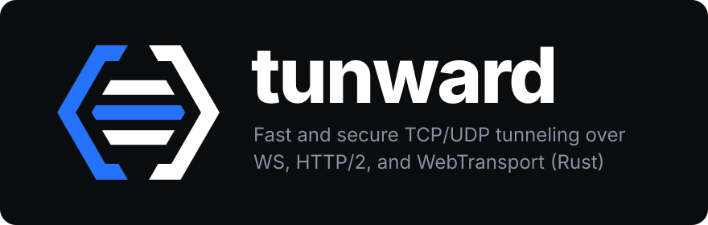

  

# Tunward

Tunward forwards TCP and UDP traffic over WebSocket, HTTP/2, or WebTransport.
It supports forward and reverse tunnels, SOCKS5 and HTTP proxies, Unix sockets,
stdio, and a local fleet observation API.

The workspace version is **0.1.0-beta**. This tree uses **tunnel protocol v2**:
upgrade both peers together or use a separate listener during migration. The
package version alone does not establish wire compatibility. See the
[protocol and migration guide](docs/PROTOCOL_V2.md).

Production qualification is incomplete. Completed 24–72 hour WAN evidence,
representative physical-device tests, and deployment-specific certificate and
rollback validation are still required before a production sign-off.

The v0.1 beta has a sufficient feature baseline for controlled evaluation. The
next milestone is secure defaults and qualification: public-listener
TLS/authentication/access-policy requirements, explicit development exceptions,
default-deny tunnel access, initial resource limits, and negative startup tests.
These default-policy changes are **planned, not implemented in `v0.1.0-beta`**.
See the [roadmap and stable-release gates](ROADMAP.md).

The public `main` history was rewritten on 2026-10-21 to remove the three old
development private keys. If you cloned earlier, use a fresh clone and reapply
reviewed source changes without merging old history. Cache/fork cleanup and
rotation of any deployed old keys require separate action; see the
[publication guide](docs/PUBLICATION.md). This work is submitted for beta review,
with the qualification gates above still open.

## Documentation

| Guide | Contents |
| --- | --- |
| [Roadmap](ROADMAP.md) | v0.1 beta scope, planned secure defaults, architectural limits, and stable-release gates |
| [mTLS and certificates](docs/using_mtls.md) | Generate local certificates, configure trust, and separate deployment keys |
| [Protocol v2](docs/PROTOCOL_V2.md) | Framing, readiness, shutdown, migration, and implementation limits |
| [Device quotas](docs/DEVICE_QUOTAS.md) | Verified identities, session/tunnel admission, request rate, and bandwidth shaping |
| [Device revocation](docs/DEVICE_REVOCATION.md) | Live certificate/device denial and termination of active work |
| [Tenant isolation and roles](docs/TENANT_ISOLATION.md) | Verified membership, named destination scope, and reverse resource ownership |
| [Fleet and inventory](docs/FLEET_INVENTORY.md) | Consistent transport records and persistent verified-device observations |
| [Deployment lifecycle](docs/DEPLOYMENT.md) | Certificate validation, renewal, canary rollout, and rollback |
| [Publication cleanup](docs/PUBLICATION.md) | Exposed-key history, safe mirror preparation, and hosting cutover |
| [Qualification](docs/STAGING_QUALIFICATION.md) | Local, container, WAN, capacity, and endurance checks |
| [Contributing](CONTRIBUTING.md) | Build requirements, Docker/Podman tests, and CI |
| [Security policy](SECURITY.md) | Private reporting, trust boundaries, and known gaps |

## Build and release artifacts

CI currently uses Rust 1.97. The manifests use edition 2024 and do not declare a
separate minimum supported Rust version.

~~~sh
git clone https://github.com/fahmikemal/tunward.git
cd tunward
cargo build --release --locked -p tunward-cli
./target/release/tunward --version
./target/release/tunward --help
~~~

The examples below use `tunward` on PATH; substitute
`./target/release/tunward` when running directly from this checkout.

The [release workflow](.github/workflows/release.yaml) defines Linux, macOS,
Windows, Android, and FreeBSD build targets. Check the actual assets on the
[releases page](https://github.com/fahmikemal/tunward/releases) before choosing a
binary. A matrix entry does not establish runtime qualification on that platform.
Privileged TProxy is Linux-specific, and Unix sockets require an appropriate OS.

## Check server configuration

Add `-t` (or `--test-config`) to the same server command you intend to run:

~~~sh
tunward server -t \
  --tls-certificate /etc/tunward/tls/server.pem \
  --tls-private-key /etc/tunward/tls/server.key \
  --tls-client-ca-certs /etc/tunward/tls/client-ca.pem \
  --restrict-config /etc/tunward/restrictions.yaml \
  --tenant-config /etc/tunward/tenants.yaml \
  --device-quota-config /etc/tunward/quotas.yaml \
  --device-revocation-config /etc/tunward/revocations.yaml \
  wts://0.0.0.0:8443
~~~

Success prints `tunward: configuration test is successful` to stderr and exits
with code `0`. Invalid configuration exits with code `1`; CLI usage errors exit
with code `2`. The check reads the selected YAML/PEM files, validates policy
values and tenant/role/restriction references, checks the certificate/key match
and client trust bundle, and checks TLS/mTLS and transport prerequisites.
When an authenticated feature lacks TLS/mTLS, the error names that feature.
Restriction YAML rejects unknown fields and descending port ranges. These same
checks apply at server startup; correct previously ignored field typos before upgrading.

In accordance with enterprise secure defaults, any public or non-loopback listener
(such as `0.0.0.0`, `[::]`, LAN, WAN, or non-localhost hostnames) strictly requires TLS
(`wss://` or `wts://`), client certificate verification (`--tls-client-ca-certs`), and
an explicit restriction policy (`--restrict-config`). For isolated local testing across
interfaces, operators may supply `--allow-insecure-dev` to bypass these prerequisites
(note: `--allow-insecure-dev` emits prominent security warnings on startup and does not
relax loopback enforcement on `--management-api`). Loopback listeners (`127.0.0.1`,
`localhost`, `[::1]`) remain unrestricted for rapid local development.

Run it as the service user, with the intended arguments, environment and file
permissions. It does not bind ports, resolve addresses, contact peers, start
watchers, create an inventory database, or write TLS key logs. It can run while
the existing server continues serving connections. It does not apply changes or
prove port availability, inventory writability/schema compatibility, DNS/network
reachability, certificate expiry/hostname/issuer trust, or production readiness.
Use the [certificate lifecycle checker](docs/DEPLOYMENT.md#validate-certificates-before-activation)
for certificate deployment checks. Omitting server identity files still permits
the development self-signed fallback; a successful check does not make it trusted.

This validates the files supplied through existing server options; there is no
unified `-c` configuration file. Validation reads files at that moment; keep
candidates immutable until activation. See the [deployment procedure](docs/DEPLOYMENT.md).

## Graceful file configuration reload

On a Unix server, add `--graceful-reload` to enable explicit reload through
SIGHUP, or add `--reload-socket /run/tunward/reload.sock` for acknowledged reload
(which also enables SIGHUP). The socket's parent must already exist with mode
`0700`; the server creates a mode-`0600` socket and refuses to overwrite an
existing path. The [systemd template](deploy/tunward.service) sets up that private
runtime directory and enables this mode.

~~~sh
tunward reload --socket /run/tunward/reload.sock
# With the installed service template:
sudo systemctl reload tunward
~~~

The command waits for validation and activation, prints the applied generation,
and exits `0`. A rejected candidate exits nonzero and leaves the active
restriction/quota/tenant/TLS generation intact. SIGHUP reports its result in the
server log; use the socket command when completion must be acknowledged.

| Change at the configured file paths | Managed reload behavior |
| --- | --- |
| Restriction rules | Validated with tenant references and used for new tunnel requests; existing forwarding stays open |
| Device quotas | Existing counts and token credit are preserved; new admissions use new caps, existing payload streams use new shaping rates |
| Tenant membership, roles, and resource scope | New requests use the current policy; removed, moved, or reduced grants disconnect that device's sessions and retained reverse listeners; equivalent/expanded grants and other devices stay connected |
| Server certificate/key and client CA | TCP and QUIC acceptors switch for new handshakes; established sessions retain their original TLS authentication |
| Device revocation | Keeps its independent one-second fail-closed reload and can terminate active work even when a grouped reload is rejected |
| Listener address/port, transport enablement, file paths, inventory options, proxy/DNS/heartbeat/startup arguments | Restart required |

In managed mode, restriction and TLS file watchers are disabled: edit all
candidates, validate them with `server -t`, then request one reload. The default
mode retains its earlier restriction/TLS automatic watching and startup-only
quotas/tenants. Reload does not reread environment variables or change CLI
arguments. Removing a CA or tightening a destination restriction does not revoke
already-admitted streams; use explicit device/certificate revocation when they
must close immediately.

This is an in-process generation switch, not an atomic filesystem publication
or a distributed transaction. Publish reviewed, immutable candidates before
reloading. Validate certificate expiry/hostname/issuer trust separately. A
control timeout leaves the outcome unconfirmed; inspect the server generation
log before retrying. The portable library API is `ServerReload` with
`run_server_with_reload`; CLI control sockets and SIGHUP require a Unix server.
Qualification remains beta; see [reload deployment and limits](docs/DEPLOYMENT.md).

## Containers

The product [Dockerfile](Dockerfile) builds a Debian runtime image with a non-root
`app` user. Build the current checkout instead of assuming a published `latest`
image already contains these changes:

~~~sh
docker build -t tunward:local .
docker run --rm tunward:local /home/app/tunward --help
~~~

The image uses `dumb-init` as its entrypoint. When overriding its default command,
invoke `/home/app/tunward` followed by the usual client/server arguments.
Provision server certificates, the server key, and trusted client CA certificates
through read-only runtime mounts; exclude the CA signing key from those mounts.
Ensure the container UID can read its own key without making it world-readable.
Local generated material is excluded from the image build context.

Tagged releases also publish to [Docker Hub: `oph1uchus/tunward`](https://hub.docker.com/r/oph1uchus/tunward).
The [release workflow](.github/workflows/release.yaml) runs only for pushed `v*`
tags, validates that the version matches both Rust packages, and waits for its
checks, native runtime matrix, and binary builds before publishing. It packages
the same Linux release binaries for `linux/amd64` and `linux/arm64` using
[Dockerfile.release](Dockerfile.release), smoke-tests both image architectures,
and records the published digest. GitHub release publication waits for the
Docker Hub job to succeed. Registry publication and GitHub release creation are
separate operations, so inspect both after a failure or rerun.

GitHub release packaging downloads only `tunward-*` binary artifacts; Docker
build records (`*.dockerbuild`) and native qualification evidence are excluded.
The packaging check verifies all fourteen binaries and restores executable file
modes before archiving, including Android ARMv7. Archives contain the original
Rust binaries, LICENSE, and the tagged README; packaging needs no Go placeholder
builds. `checksums.txt` and `release-manifest.json` record archive/binary hashes,
the source commit, and build run ID. If only GitHub packaging failed after image publication,
the guarded [prerelease recovery workflow](.github/workflows/release-recovery.yaml)
can reuse that tag's successful build artifacts. See
[recovery prerequisites and limits](CONTRIBUTING.md#recover-a-partial-prerelease).

The image tag equals the Git tag; beta tags do not create a `latest` or stable
alias. After `v0.1.0-beta` has actually been published, for example:

~~~sh
docker pull oph1uchus/tunward:v0.1.0-beta
docker run --rm oph1uchus/tunward:v0.1.0-beta /home/app/tunward --version
~~~

Maintainers must configure the GitHub Actions variable `DOCKERHUB_USERNAME`
and secret `DOCKERHUB_TOKEN` (a Docker Hub token with write access to this image).
Without them, the release fails before builds start. Branch and PR CI never
push images. This workflow change alone does not publish an image or qualify
the release for production. See [release setup](CONTRIBUTING.md#ci-and-releases).

Publish the TLS TCP port explicitly, and also UDP when using WebTransport.
Choose a loopback host publication unless public access is intended. Addresses
such as `127.0.0.1` inside a container refer to that container, not the host;
adapt target routing and restriction rules to the actual network. Docker and
Podman execution both need environment-specific permission and UID validation;
see [container qualification](docs/STAGING_QUALIFICATION.md#container-feature-checks).

## Quickstart: verified local mTLS

Python 3 and OpenSSL are needed to generate this development bundle. They are
not required to run an already configured tunward binary.

~~~sh
python3 scripts/generate_mtls.py
~~~

The output is `certs/mTLS/generated/`: a new CA, a server certificate for
`localhost`, `127.0.0.1`, and `::1`, and a client with CN
`tunward_client_1`. The script verifies the certificate chains, purposes, names,
and matching keys. It refuses to overwrite an existing output directory.

In one terminal, run a local target service:

~~~sh
mkdir -p target/demo-site
printf 'tunward local demo\n' > target/demo-site/index.html
python3 -m http.server 3000 --bind 127.0.0.1 --directory target/demo-site
~~~

From the repository root, start the tunnel server in another terminal:

~~~sh
tunward server \
  --tls-certificate certs/mTLS/generated/certs/tunward-server.cert.pem \
  --tls-private-key certs/mTLS/generated/private/tunward-server.pem \
  --tls-client-ca-certs certs/mTLS/generated/certs/ca.cert.pem \
  --restrict-to 127.0.0.1:3000 wss://127.0.0.1:8443
~~~

Then start the client from the repository root. This trust-store example is for
Linux/POSIX shells; see the mTLS guide for platform boundaries.

~~~sh
SSL_CERT_FILE="$PWD/certs/mTLS/generated/certs/ca.cert.pem" SSL_CERT_DIR= \
tunward client --tls-verify-certificate \
  --tls-certificate certs/mTLS/generated/certs/tunward-client-1.cert.pem \
  --tls-private-key certs/mTLS/generated/private/tunward-client-1.pem \
  -P tunward_client_1 \
  -L tcp://127.0.0.1:8088:127.0.0.1:3000 wss://127.0.0.1:8443
~~~

~~~sh
curl http://127.0.0.1:8088/
~~~

The client's destination `127.0.0.1:3000` is reached from the **server** for a
forward tunnel. In this local example both happen to run on the same computer.
The inner HTTP request is application traffic carried by the mTLS tunnel.

## Transports

| Client URL | Transport | Server setup |
| --- | --- | --- |
| `ws://` | WebSocket over TCP | `ws://` listener; cleartext |
| `wss://` | WebSocket over TLS/TCP | TLS listener and a server certificate trusted by the client |
| `http://` | HTTP/2 over cleartext TCP | Cleartext listener |
| `https://` | HTTP/2 over TLS/TCP | TLS listener; preserve end-to-end streaming |
| `wts://` | WebTransport over HTTP/3/QUIC | `wts://`, or `wss://` with `--enable-webtransport` |

The server detects WebSocket and HTTP/2 on its TCP listener. A `wts://` server
also opens UDP on the same port and retains its TLS TCP listener. Publish both
TCP and UDP through firewalls/container mappings when using all TLS transports.

For the local mTLS recipe, change only the client URL scheme to `https://` to
try HTTP/2. To try WebTransport, change the server URL to
`wts://127.0.0.1:8443` and the client URL to the same scheme, keeping the
certificate and restriction options.

A reverse proxy must preserve the selected protocol and bidirectional streaming;
buffering or an HTTP/2-to-HTTP/1 downgrade can break the tunnel. WebTransport
needs QUIC/UDP reachability. Its client races resolved addresses with a 250 ms
stagger and at most four attempts in flight, within the connection timeout, so
a stalled IPv6 route does not postpone every IPv4 attempt. Its current client rejects `--http-proxy`,
`--tls-sni-disable`, and `--tls-ech-enable`.

## Tunnel specifications

Repeat `-L` and `-R` to configure several listeners in one client. The following
are argument examples to combine with your transport and TLS options.

| Argument | Meaning |
| --- | --- |
| `-L tcp://127.0.0.1:8088:127.0.0.1:3000` | Local TCP listener, destination reached from the server |
| `-L udp://127.0.0.1:5353:127.0.0.1:53?timeout_sec=30` | Local UDP listener with inactivity timeout |
| `-L socks5://127.0.0.1:1080` | Local SOCKS5 proxy; destinations remain subject to server restrictions |
| `-L http://127.0.0.1:8082` | Local HTTP forward/CONNECT proxy |
| `-L unix:///tmp/tunward.sock:127.0.0.1:3000` | Local Unix socket ingress |
| `-L stdio://127.0.0.1:22` | Stdin/stdout ingress, useful in SSH ProxyCommand |
| `-R tcp://127.0.0.1:9000:127.0.0.1:3000` | Listener on the server, destination reached from the client |
| `-R tcp://127.0.0.1:0:127.0.0.1:3000` | Request a reverse TCP port; tenant mode selects from its reserved pool |
| `-R udp://127.0.0.1:5353:127.0.0.1:53` | Reverse UDP |
| `-R socks5://127.0.0.1:1081` | SOCKS5 listener on the server, outbound traffic from the client |
| `-R http://127.0.0.1:8083` | HTTP proxy listener on the server |
| `-R unix:///tmp/tunward-reverse.sock:127.0.0.1:3000` | Reverse Unix socket |

Quote specs containing `&` or shell metacharacters. Proxy listeners can require
credentials using `?login=NAME&password=VALUE`; protect those values from shell
history and logs. Keep listeners on loopback unless remote access is explicitly
intended. The client help has stale text saying reverse mode supports only TCP;
the parser and handlers also implement the reverse variants listed above.

`timeout_sec=0` disables a UDP listener's inactivity timeout. For a WireGuard
tunnel, keep a route to the tunward server outside the WireGuard tunnel to avoid
routing recursion. TProxy TCP/UDP and `--socket-so-mark` need suitable Linux
capabilities/routing; the generic examples do not configure those privileges.

Reverse listener release is asynchronous and depends on transport teardown,
active waiters, and the server idle timeout. Port zero normally asks the OS for
a port; tenant mode instead samples up to 32 candidates from its reserved pool.
Neither is a persistent reservation. Cached reverse listener reuse is always
scoped to the verified mTLS device and Server instance, independently of quotas
and revocation. With quotas enabled, retained allocations also remain charged.

## Fleet observation API

Add `--management-api 127.0.0.1:8081` to the server command. For a local reverse
demo, replace `--restrict-to` with an explicit
[reverse-listener rule](docs/using_mtls.md#destination-and-reverse-listener-policy).
Use the client TLS options from the quickstart with a reverse spec and, for
example, `--client-id dev-device-001`.

~~~sh
curl --fail http://127.0.0.1:8081/healthz
curl --fail http://127.0.0.1:8081/api/v1/clients
curl --fail http://127.0.0.1:8081/api/v1/clients/dev-device-001
curl --fail http://127.0.0.1:8081/api/v1/sessions
curl --fail http://127.0.0.1:8081/api/v1/connections
~~~

The API accepts loopback binds and documented GET routes. It has no built-in API
authentication, enrollment, remote command execution, or quota-editing endpoint.
Use an authenticated TLS gateway for remote access. Unknown routes, methods,
and missing records return 404.

`--client-id` (alias `--device-id`) and the corresponding handshake headers
remain caller-supplied labels. WebSocket, HTTP/2, and WebTransport share
connection/tunnel registration and cleanup. Session records distinguish
`kind: tunnel` from `kind: reverse_listener`, with transport, connection ID, and
verified device CN when available. `/api/v1/connections` records actual peer
addresses; forwarded headers do not establish peer identity.

For persistent observations of authenticated devices, create a private state
directory and add `--fleet-inventory state/devices.sqlite3` to the mTLS server
command. The inventory requires `--tls-client-ca-certs` and verified TLS;
`--fleet-inventory-max-devices` defaults to 10000. Store this directory on a
persistent local volume for containers. It is excluded from Git and image
build contexts.

~~~sh
mkdir -m 700 state
# Run the mTLS server with --fleet-inventory state/devices.sqlite3, then:
curl --fail 'http://127.0.0.1:8081/api/v1/devices?limit=100'
curl --fail http://127.0.0.1:8081/api/v1/devices/device-001
~~~

The SQLite inventory survives restart and certificate rotation with a stable CN.
It contains first/last authentication observations and the latest certificate
fingerprint; live counts remain in memory and start at zero after restart.
Caller labels cannot create verified device records. Device queries return 503
when persistence is disabled/unavailable; invalid pagination returns 400.
Configured persistence failures reject new connection admission rather than
silently lose observations, while existing forwarding continues. Read
[the fleet guide](docs/FLEET_INVENTORY.md) for counters, capacity, permissions,
backup, migration, and failure recovery. These observations do not prove physical
MDM enrollment, tenant ownership, or end-to-end device health.

## Useful CLI options

The complete CLI reference for your binary is:

~~~sh
tunward client --help
tunward server --help
~~~

| Option | Current behavior |
| --- | --- |
| `--tls-verify-certificate[=true\|false]` | Client verification defaults to true; keep enabled for deployments |
| `--tls-certificate`, `--tls-private-key` | Server identity or client mTLS identity, depending on subcommand |
| `--tls-client-ca-certs FILE` | Server trust bundle for client certificate authentication |
| `--device-quota-config FILE` | Startup-loaded per-device quotas; requires mTLS and uses verified CNs |
| `--device-revocation-config FILE` | Live mTLS CN/certificate denial; closes active sessions and reverse resources |
| `--tenant-config FILE` | Startup-loaded device membership, tunnel roles, and reserved reverse scope; requires mTLS and named `--restrict-config` rules |
| `--fleet-inventory FILE` | Persistent SQLite observations of verified mTLS devices |
| `--fleet-inventory-max-devices N` | Maximum stored device identities; default 10000 |
| `-P, --http-upgrade-path-prefix VALUE` | Client path prefix; mTLS uses the certificate CN by default |
| `-r, --restrict-http-upgrade-path-prefix VALUE` | Server path allowlist; not a substitute for TLS and target rules |
| `--restrict-to HOST:PORT` | Server forward-destination allowlist; repeat as needed |
| `--restrict-config FILE` | Reloadable YAML restriction rules; replaces CLI-generated restriction rules |
| `--allow-insecure-dev` | Explicit exception permitting cleartext or unauthenticated non-loopback listeners for local testing; emits security warnings |
| `-c, --connection-min-idle N` | Idle pool setting, default 0; accepted range 0..1000; WebTransport clamps to one session |
| `--connection-retry-max-backoff DURATION` | Pool acquisition deadline, default 5m, must be nonzero |
| `--reverse-tunnel-connection-retry-max-backoff DURATION` | Reverse reconnect backoff ceiling, default 1s |
| `--remote-to-local-server-idle-timeout DURATION` | Server reverse-listener idle checking, default 3m |
| `--websocket-ping-frequency DURATION` | Default 30s; zero disables WebSocket pings |
| `--dns-resolver URL` | Resolver selection, including system, UDP DNS, DNS-over-TLS/HTTPS |
| `--log-lvl LEVEL` | Logging filter; default INFO |

Durations accept integer seconds, optionally suffixed `s`, `m`, or `h`.
Reverse reconnects use bounded randomized backoff. Retry settings and pool
deadlines are not a throughput, fairness, or availability guarantee.

## Certificates and public repositories

The repository supplies [a generator](scripts/generate_mtls.py) and an
[OpenSSL template](certs/mTLS/openssl.cnf). Each operator generates their own CA
and keys. Development material under `certs/mTLS` is ignored by Git and excluded
from Docker build contexts; keep custom output directories excluded too.

A CA certificate (`ca.cert.pem`) is public trust material. The CA private key
(`ca.key.pem`) can issue trusted certificates and must remain with the issuer.
Server/device private keys belong only with their respective owners. Public
distribution of the tool does not require publishing deployment keys.

For deployment, provision a server certificate with SANs matching the actual
domain/IP and a distinct client identity/key per device. A publicly issued
server certificate can be combined with a private client CA. Renewal under the
same CA does not require replacing that CA; a CA change needs a coordinated
trust-bundle migration. Previously published keys must not be reused for
deployment, even after their removal from the advertised branch history.

The development generator is not a production enrollment or certificate
lifecycle service. See [the mTLS guide](docs/using_mtls.md) for file placement,
Docker/Podman boundaries, and rotation. Use the [deployment runbook](docs/DEPLOYMENT.md)
for candidate validation, rollout, rollback, and issuer migration; use the
[publication guide](docs/PUBLICATION.md) for the history cutover and remaining cleanup.

## Deployment and qualification limits

Use verified TLS, mTLS where required, narrow forward/reverse rules, and an
isolated management endpoint. Default unrestricted listeners and the embedded
development server certificate are unsuitable as a complete production setup.

Optional [device quotas](docs/DEVICE_QUOTAS.md) limit sessions, active/pending
tunnel work, request rate, and upload/download payload by verified mTLS CN across
the three TLS transports. Enable them with `--device-quota-config` and adapt
[the example](device-quotas.example.yaml) to a measured workload. They are
disabled by default, loaded at startup, and local to one Server instance.
They do not persist usage across restart or coordinate multiple replicas.

Optional [device revocation](docs/DEVICE_REVOCATION.md) blocks individual leaf
certificates by SHA-256 fingerprint or all keys of a verified device CN. Add
`--device-revocation-config device-revocations.example.yaml` to the mTLS server
command. Publish changes by atomic file replacement; the policy reloads every
second and closes affected WSS, HTTP/2, and WebTransport sessions, forwarding,
and reverse listeners. An unreadable or invalid file denies new authenticated
access and closes existing sessions until a valid policy returns. The
[example](device-revocations.example.yaml) starts with empty deny lists.
This is a local access policy, with no X.509 CRL/OCSP ingestion or automatic
cross-replica distribution. Coordinate policy delivery and monitor reload errors.

Optional [tenant authorization](docs/TENANT_ISOLATION.md) binds verified device
CNs to one tenant and explicit tunnel roles. Add
`--tenant-config tenant-policy.example.yaml` and
`--restrict-config tenant-restrictions.example.yaml` to the mTLS server command,
replacing `--restrict-to`. Adapt the [tenant policy](tenant-policy.example.yaml)
and its [named restriction rules](tenant-restrictions.example.yaml) together. Roles, tenant rule scope, existing destination rules, and reserved
reverse endpoints must all permit a request. Unknown devices are denied;
header labels cannot choose roles or tenants. Policy contents support managed
reload; changing startup file paths requires restart.

Reverse listeners cannot be reused by another verified device, even without
these optional policies. Tenant mode also separates bind pools and exact Unix
paths and prevents direct forwarding to the configured management API port.
Live records expose trusted tenant/role metadata. The management API remains a
global operator interface; OS/network isolation and cross-replica coordination
need separate deployment controls.

Local checks, WAN investigation, and container checks cover bounded workloads.
They do not establish enterprise certification, maximum device counts, or a
24-hour WAN SLO. Dedicated runners now cover isolated privileged IPv4 TProxy,
controlled DNS/DoT/DoH and ECH edge cases, certificate key/issuer renewal and
rollback, and portable native runtime smoke checks. Native macOS/Windows CI
gates require actual successful runs; real CDN/ECH, physical
MDM devices, and completed long-duration evidence remain deployment gates.
The native runner uses an explicit OpenSSL configuration to keep host-default
extensions out of its test CA and CSRs, checks certificate chains and purposes
before starting tunnels, and records the OpenSSL version and setup failures.
CI writes native evidence outside the Cargo target cache, to a temporary path
unique to each workflow run and attempt; cached results and test keys are not
reused as a new run's output.
All protocol/security qualification CI profiles also use a run-specific
temporary root. CI removes legacy generated qualification fixtures restored
inside the build cache; local scripts keep their refusal to overwrite evidence.
CI uploads qualification artifacts only after the per-run output root is set.
If the host rejects a 40 KB UDP send with `EMSGSIZE`, the native runner records
that large-datagram case as `not_run` and still verifies an 8 KiB datagram on
each transport. This does not establish 40 KB UDP support on that host.
Its fallback regression test injects the size-limit error and verifies a real
UDP exchange, avoiding assumptions about how each OS rejects oversized sends.
The [qualification guide](docs/STAGING_QUALIFICATION.md)
describes reproducible gates and the unresolved historical WSS WAN timeout.

Verify periodic WAN evidence with `scripts/verify_wan_endurance.py`; a stopped
job, missing receipt, failed SSH setup, or incomplete check matrix cannot pass.
The controller records SIGINT/SIGTERM interruptions and stops its active child.
Forced termination or a host crash can still leave no receipt, which fails verification.

The lockfile includes the TLS fixes in `rustls-webpki 0.103.16` and
`webpki-root-certs 1.0.10` for
[RUSTSEC-2026-0382](https://rustsec.org/advisories/RUSTSEC-2026-0382.html) and
[RUSTSEC-2026-0383](https://rustsec.org/advisories/RUSTSEC-2026-0383.html).
Rebuild with `--locked` and requalify the resulting binary; evidence from a
previous binary does not establish readiness of this one. Run a fresh dependency
audit before release, including separate review of maintenance and yanked-package warnings.

Replacing a staging server requires a fresh qualification window, disposable test
CA, and matching client/server binary hashes. Preserve the previous host's results
separately; durations from different hosts or interrupted runs cannot be combined
into a continuous endurance result. The WAN verifier also rejects cycles whose
agent manifest changes, even when the binary is identical. See
[staging replacement](docs/STAGING_QUALIFICATION.md#replacing-a-staging-host).
The staging-local verifier reports a running service even before its first
progress file is written; missing results never establish a completed test.

For unattended WAN qualification, run the client and verdict collection on a
separate always-on machine so the operator's laptop can disconnect. On an
explicitly approved shared host, bound the entire test process group with CPU,
memory, swap, and task limits and stop the test when host headroom drops. Keep
test files separate from application data. See the
[qualification guide](docs/STAGING_QUALIFICATION.md#unattended-wan-client).
A guard-stopped run remains incomplete even if earlier cycles passed. Use a
dedicated client host when uninterrupted qualification conflicts with protecting
production workloads.

## Acknowledgements

Tunward is built upon the foundational work of [wstunnel](https://github.com/erebe/wstunnel)
by Romain Gerard ([@erebe](https://github.com/erebe)), licensed under the BSD 3-Clause License.
Tunward redesigns the wire framing as Protocol v2 and introduces carrier-grade
enterprise controls including authenticated device quotas, live revocation, tenant
isolation, and persistent fleet inventory.

## License

Tunward is licensed under the Apache License, Version 2.0. It incorporates software
originally developed by Romain Gerard (Erèbe) under the BSD 3-Clause License.
See [LICENSE](LICENSE) and [NOTICE](NOTICE) for full details.
